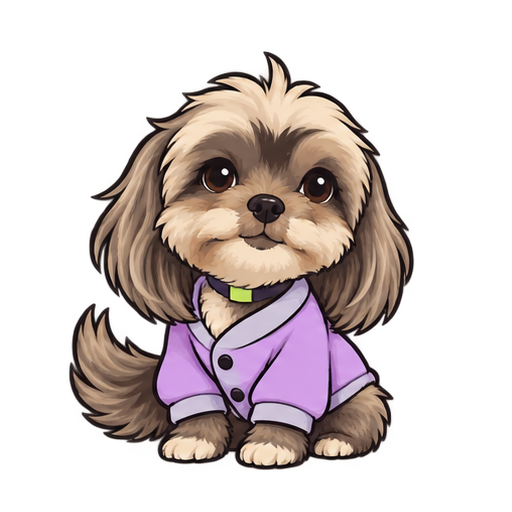

# Amy y Molly: sprites animados de Moyami

Primera versión de las dos mascotas, basada en las fotografías facilitadas y en la dirección visual elegida de Bipoki. La identidad de las mascotas acompaña a Moyami.

## Contenido por personaje

- `*-animada.webp`: animación con transparencia completa, recomendada para la futura web.
- `*-animada.png`: APNG animado con transparencia completa.
- `*-animada.gif`: versión GIF; su transparencia es binaria por las características del formato.
- `*-estatica.png`: primer cuadro para piezas fijas o movimiento reducido.
- `*-spritesheet.png`: hoja registrada de 4 columnas por 2 filas, de 2048 x 1024 px; cada cuadro mide 512 x 512 px.
- `*-spritesheet-original.png`: ilustración original generada, sin modificar.
- `*-frame-00.png` a `*-frame-07.png`: ocho cuadros individuales registrados por las patas.
- `*-sprites.json`: orden, duración y coordenadas de los cuadros.

Las animaciones muestran un parpadeo y cambios de posición de la cola. El ciclo dura 1920 ms y se repite. Se alinearon los cuadros sin repintar el arte. Como primera versión generada, puede haber pequeñas variaciones del dibujo entre cuadros.

## Identidad visual

Carbón #18201A; lima #C8F04A; lila #A792EF; tiza #F7F8F2. Amy conserva el pelaje gris/marrón, las orejas caídas y la chaqueta lila. Molly conserva el pelaje tricolor y los ojos amarillo-verdosos, con bandana lima y detalle lila.

## Uso básico en la futura landing

```html
<picture>
  <source media="(prefers-reduced-motion: reduce)" srcset="amy/amy-estatica.png">
  
</picture>
```

La versión estática permite respetar la preferencia del visitante de reducir movimiento. Para Molly se cambia el prefijo `amy` por `molly`.

Los personajes acompañan a la marca de snacks y bebidas asiáticos. El nombre elegido de la empresa es Moyami. La especificación de ilustración está en `prompts-ilustracion.txt`.
